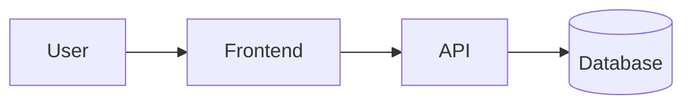

# Design

How the system is built. The *why* behind each big choice is recorded in [docs/decisions/](docs/decisions/). The *what and for whom* is in [docs/PROJECT.md](docs/PROJECT.md).

Keep this file current. If the code and this file disagree, fix one of them in the same change.

## Overview
[2–4 sentences: the main parts of the system and how a request or data flows through them.]



## Tech stack
| Layer | Choice | Why (short) | ADR |
|---|---|---|---|
| Language / runtime | [e.g. TypeScript, Node 22] | | [0002](docs/decisions/) |
| Frontend | | | |
| Backend / API | | | |
| Database | | | |
| Tests | | | |
| Hosting / CI | | | |

## Components
| Component | Responsibility | Lives in | Talks to |
|---|---|---|---|
| [name] | [one line] | `src/[...]` | [other components] |

## Directory layout
```text
src/
  [module]/      # [what belongs here]
tests/
  [unit|e2e]/
docs/
```

## Data model
[The main entities, their key fields and relations. A small table or an ER diagram is enough.]

## Interfaces
[Public APIs, events and contracts between components. Link to an OpenAPI or schema file if one exists.]

## Cross-cutting concerns
- **Auth:** [how users authenticate, where permissions are checked]
- **Errors:** [how errors are represented, logged and shown to users]
- **Config and secrets:** environment variables, listed in `.env.example`
- **Logging and monitoring:** [what, where]

## Non-functional targets
[Copied from PROJECT.md requirements, e.g. p95 latency < 300 ms, 500 concurrent users.]

## UI (if the project has one)
[The design system: colors, typography, spacing, and the component library to use. Link screenshots or a Figma file. Or move this section to `docs/design-system.md` when it grows.]
